Лабораторная работа №1
Указатели

Задача 1:
Внутри функции int main(void) { /*...*/ } определите указатель: double ***pointer = NULL; Инициализируйте этот указатель адресом другого указателя типа double **, который указывает, в свою очередь, на переменную double. Используйте pointer для записи и чтения в эту переменную значения 2. При этом выполните следующее: - Используйте функции типа *alloc(...) для выделения оперативной памяти под динамические объекты; - Запишите и выведите число 2 на экран, используя указатель double ***pointer = NULL;; - Используйте функцию free(...) для освобождения оперативной памяти, выделенной под динамические объекты. - Не используйте никаких идентификаторов переменных, кроме pointer.

Список идентификаторов 1:

| Имя переменной | Тип данных | Смысловое обозначение                                            |
| -------------- | ---------- | ---------------------------------------------------------------- |
| pointer        | double***  | Тройной указатель; хранит адрес указателя на указатель на double |

Код программы 1:
```c
#include <stdio.h>    

#include <stdlib.h>  

  

int main() {

    double ***pointer = NULL;

  

    pointer = malloc(sizeof(double**));

    *pointer = malloc(sizeof(double*));

    **pointer = malloc(sizeof(double));

  

    ***pointer = 2.0;

    printf("Value - %f", ***pointer);

  

    free(**pointer);

    free(*pointer);

    free(pointer);

  

    return 0;

}
```

Результат работы программы 1:

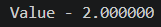

Задача 2:
Напишите программу, которая создает одномерный динамический массив из чисел с плавающей точкой двойной точности, заполняет его значениями с клавиатуры и выводит все элементы массива, используя арифметику указателей (оператор +), а не оператор доступа к элементам массива [].

Список идентификаторов 2:

| Имя переменной | Тип данных | Смысловое обозначение                                                                                  |
| -------------- | ---------- | ------------------------------------------------------------------------------------------------------ |
| n              | int        | Размер массива (количество элементов), вводится пользователем                                          |
| array          | double*    | Указатель на первый элемент динамического массива; хранит адрес блока памяти, выделенного через malloc |
| i              | int        | Счётчик цикла; используется для итерации по элементам массива                                          |

Код программы 2:
```c
#include <stdio.h>

#include <stdlib.h>

  

int main() {

  

    int n;

    printf("Enter the array size: ");

    if (scanf("%d", &n) != 1 || n <= 0) { //защита от ввода букв и ненатуральных чисел

        printf("Incorrect input");

        return 1;

    }

  

    double *array = malloc(n * sizeof(double)); // n * тк выделяем под n кол-во элементов (n * 8байт)

  

    if (array == NULL) { //Если свободной памяти не будет, то malloc вернет NULL

        printf("Memory allocation failed"); //При реализации такого кода будет ошибка

        return 1; //Поэтому досрочно завершаем её таким образом

    }

  

    printf("Enter the array: ");

    for (int i = 0; i < n; i++)

        scanf("%lf", array + i); //записываем в ячуйку памяти

    printf("Array elements: ");

    for (int i = 0; i < n; i++)

        printf("%f ", *(array + i)); //выписываем элемент из ячейки памяти

  

    free(array);

  

    return 0;

}
```

Результат работы программы 2:

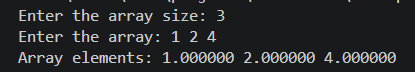

Задача 3:
Выделите память под двумерный динамический массив двумя способами: классическим и непрерывным. После выполнения программы обязательно корректно освободите всю выделенную оперативную память с помощью free().

Список идентификаторов 3:

| Имя переменной | Тип данных | Смысловое обозначение                                                            |
| -------------- | ---------- | -------------------------------------------------------------------------------- |
| rows           | int        | Количество строк матрицы                                                         |
| cols           | int        | Количество столбцов матрицы                                                      |
| matrix         | double**   | Указатель на указатель; хранит адрес "оглавления" — массива указателей на строки |
| i              | int        | Счётчики циклов по строкам                                                       |
| k              | int        | Счётчик цикла отката при ошибке выделения памяти                                 |
| j              | int        | Счётчики циклов по столбцам                                                      |
Классический способ.

| Имя переменной | Тип данных | Смысловое обозначение                                                                                                   |
| -------------- | ---------- | ----------------------------------------------------------------------------------------------------------------------- |
| rows           | int        | Количество строк матрицы                                                                                                |
| cols           | int        | Количество столбцов матрицы                                                                                             |
| data           | double*    | Указатель на начало непрерывного блока памяти, содержащего все элементы матрицы                                         |
| matrix         | double**   | Указатель на "оглавление" — массив указателей, каждый из которых указывает на начало соответствующей строки внутри data |
| i              | int        | Счётчики циклов по строкам                                                                                              |
| j              | int        | Счётчик циклов по столбцам                                                                                              |
Непрерывный способ.

Код программы 3:
```c
#include <stdio.h>

#include <stdlib.h>

  

int main() {

    int rows, coals; //ввод кол-ва строк и столбцов

    printf("Enter rows and coals: ");

    if (scanf("%d %d", &rows, &coals) != 2 || rows <= 0 || coals <= 0) {

        printf("Incorrect input");

        return 1;

    } //Защита от плохогго ввода, должно быть 2 числа и они >0

  

    double **matrix = malloc(rows * sizeof(double*));

    //выделение памяти под оглавление(массив указателей)

  

    for (int i = 0; i < rows; i++) {

        *(matrix + i) = malloc(coals * sizeof(double));//выделяем память под каждую строку

        if (*(matrix + i) == NULL) {

            //Если память кончилась, то вырубаем и чистим всё, что накопили

            printf("Memory allocation failed");

            for (int k = 0; k < i; k++)

                free(*(matrix + k)); //Освобождаем строчки, которые уже заполнились

            free(matrix); //Освобождаем оглавление

            return 1;

        }

    }

  

    printf("Enter the matrix: ");

    for (int i = 0; i < rows; i++) {

        for (int j = 0; j < coals; j++) {

            scanf("%lf", *(matrix + i) + j);

        }

    } //*(matrix + i) + j это адрес ячейки

  

    printf("Matrix elments:\n");

    for (int i = 0; i < rows; i++) {

        for (int j = 0; j < coals; j++) {

            printf("%f ", *(*(matrix + i) + j));

        }//*(*(matrix + i) + j) - разыменовывание адреса в значение

        printf("\n");

    }

  

    for (int i = 0; i < rows; i++)

        free(*(matrix + i));

    //Освобождаем все строки изнутри наружу

    free(matrix); //Чистим оглавление

  

    return 0;

}
```
Классический способ.

```c
#include <stdio.h>

#include <stdlib.h>

  

int main() {

    int rows, coals;

  

    printf("Enter rows and coals: ");

    if (scanf("%d %d", &rows, &coals) != 2 || rows <= 0 || coals <= 0) {

        printf("Incorrect input");

        return 1;

    }

  

    double *data = malloc(rows * coals * sizeof(double));

    //Непрерывный блок памяти под все элементы матрицы

    if (data == NULL) {

        printf("Memory allocation failed");

        return 1;

    }

  

    double **matrix = malloc(rows * sizeof(double*));//Память для оглавления

    if (matrix == NULL) {

        printf("Memory allocation failed");

        free(data);//Если память кончилась, то вырубаем и чистим всё, что накопили

        return 1;

    }

  

    for (int i = 0; i < rows; i++) //связка оглавления с непрерыв. блоком

        *(matrix + i) = data + i * coals;

    printf("Enter the matrix: ");

    for (int i = 0; i < rows; i++){

        for (int j = 0; j < coals; j++)

            scanf("%lf", *(matrix + i) + j);    

    }

  

    printf("Matrix elements:\n");

    for (int i = 0; i < rows; i++) {

        for (int j = 0; j < coals; j++) {

            printf("%f ", *(*(matrix + i) + j));

        }

        printf("\n");

    }

    free(data); //сначала освобождаю внутрянку

    free(matrix); // потом оглавление

  

    return 0;

}
```
Непрерывный способ.

Результат работы программы 3:

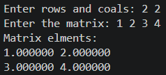

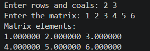


Задача 4:
Написать программу, которая использует функцию для обмена значениями двух переменных через указатели.

Список идентификаторов 4:

| Имя переменной | Тип данных | Смысловое обозначение                                                        |
| -------------- | ---------- | ---------------------------------------------------------------------------- |
| x, y (в main)  | int        | Две целочисленные переменные, значения которых нужно поменять местами        |
| x, y (в swap)  | int*       | Указатели на переменные x и y из main; хранят адреса оригинальных переменных |
| temp           | int        | Временная переменная для хранения одного из значений во время обмена         |

Код программы 4:
```c
#include <stdio.h>

  

void swap(int* x, int* y) {

    int temp;

    temp = *x;//значение х по адресу во временку

    *x = *y; //значение у по адресу в ячейку с адресом х

    *y = temp; // записываем значение временки в ячейку с адресом у

}

  

int main() {

    int x = 5, y = 10;

  

    printf("Before swap: x = %d, y = %d\n", x, y);

  

    swap(&x, &y); //вызов функции

  

    printf("After swap: x = %d, y = %d", x, y);

  

    return 0;

}
```

Результат работы программы 4:

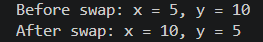

Задача 5:
Создать функцию, которая принимает массив целых чисел и его размер, а затем возвращает указатель на максимальный элемент массива.

Список идентификаторов 5:

| Имя переменной | Тип данных | Смысловое обозначение                                                                      |
| -------------- | ---------- | ------------------------------------------------------------------------------------------ |
| arr            | int*       | Указатель на первый элемент массива; передаётся в функцию find_max                         |
| size           | int        | Количество элементов в массиве                                                             |
| max_pos        | int*       | Указатель на текущий максимальный элемент; в начале указывает на arr[0], затем обновляется |
| i              | int        | Счётчик цикла; индекс текущего сравниваемого элемента                                      |
| max_el         | int*       | Указатель, в который сохраняется результат работы find_max (адрес максимального элемента)  |

Код программы 5:
```c
#include <stdio.h>

#include <stdlib.h>

  

int* find_max(int* arr, int size) {//int* тк функция возвращает указатель

    int* max_pos = arr;

    for (int i = 1; i < size; i++) {

        //Начинаем с 1 тк max_pos изначально приравнен к нулевому элементу

        if (*max_pos < *(arr+i)) //Сравнение значений

            max_pos = arr+i;  //Обновление указателя

    }

    return max_pos; //возвращение адреса

}

  

int main() {

    int arr[] = {1, 100, 3, 4, 5, 6, 7};

    int size = sizeof(arr) / sizeof(arr[0]);//Размер всего массива 7 эл * 4 байта = 28

    //Делить на размер одного элемента (4 байта)

    //4 байта тк int

  

    int* max_el = find_max(arr, size);//вызов функции

    printf("Max element: %d", *max_el); //Вывод значения которое лежало по адресу max_el

  

    return 0;

}
```

Результат работы программы 5:

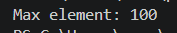

Задача 6:
Реализовать функцию, которая переворачивает массив целых чисел, используя указатели для перемещения по элементам.

Список идентификаторов 6:

| Имя переменной | Тип данных | Смысловое обозначение                                         |
| -------------- | ---------- | ------------------------------------------------------------- |
| arr            | int*       | Указатель на первый элемент массива                           |
| size           | int        | Количество элементов в массиве                                |
| left           | int*       | Указатель на элемент с начала массива; двигается вправо       |
| right          | int*       | Указатель на элемент с конца массива; двигается влево         |
| temp           | int        | Временная переменная для обмена значений между *left и *right |

Код программы 6:
```c
#include <stdio.h>

#include <stdlib.h>

  

//С таким типом функция получает доступ к массиву на прямую

void rever_arr(int* arr, int size) {

    int* left = arr;//Первый элемент массива

    int* right = arr + size - 1;//последний

    int temp;

  

    while (left < right) {

        temp = *left;

        *left = *right;

        *right = temp; //3 обмена

  

        left++; //сдвиг в право и лево

        right--;

    }

}

  

int main() {

    int arr[] = {1, 2, 3, 4, 5, 6, 7};

    int size = sizeof(arr) / sizeof(arr[0]);

  

    printf("Before reverse: ");

    for (int i = 0; i < size; i++)

        printf("%d ", *(arr + i));

    printf("\n");

  

    rever_arr(arr, size); //вызов функции

  

    printf("After reverse: ");

    for (int i = 0; i < size; i++)

        printf("%d ", *(arr + i));

  

    return 0;

}
```

Результат работы программы 6:

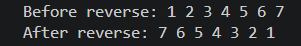

Задача 7:
Реализовать функцию, которая находит первое вхождение одной строки в другую, используя указатели вместо индексов для доступа к символам строки.

Список идентификаторов 7:

| Имя переменной | Тип данных | Смысловое обозначение                                                                          |
| -------------- | ---------- | ---------------------------------------------------------------------------------------------- |
| str            | char*      | Указатель на основную строку (где ищем)                                                        |
| substr         | char*      | Указатель на подстроку (что ищем)                                                              |
| p1             | char*      | Бегущий указатель по основной строке; используется для посимвольного сравнения                 |
| p2             | char*      | Бегущий указатель по подстроке; сбрасывается на начало при каждой новой попытке                |
| start          | char*      | "Закладка"; хранит адрес символа в основной строке, с которого началась текущая попытка поиска |
| res            | char*      | Указатель, в который сохраняется результат: адрес начала найденной подстроки или NULL          |

Код программы 7:
```c
#include <stdio.h>

  
  

char* find_substr(char* str, char* substr) {

    char* p1 = str; //передали р1 значение строки

    while (*p1 != '\0') {//чек на конец подстроки

        char* start = p1;//это закладка

        char* p2 = substr; //передал р2 значение подстроки

        while (*p1 == *p2 && *p2 != '\0') {//чек на равенство и конец строки

            p1++;//двигаемся по строке

            p2++;//двигаемя по подстроке

        }

        if (*p2 == '\0') //Если конец подстроки, значит нашли совпадение

            return start;//возвращаемся к закладке(адрес начала совпадения)

        p1 = start + 1; //если совпадения нет, то пробуем снова с другой закладки

    }

    return NULL; //если подстрока не найдена

}

  

int main() {

    char str[] = "hello world";//строка

    char substr[] = "world";//подстрока

  

    char* res = find_substr(str, substr);//вызов функции

  

    if (res != NULL) {

        printf("Substring position: %d ", res-str);

        //res-str Тк таким образом выводим количество элемнетов между ними

        printf("Substr: %s", res); //Просто вывод подстроки

        // %s для вывода строки

    } else {

        printf("Substrind not exist in string");

    }

    return 0;

}
```

Результат работы программы 7:

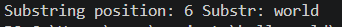

Задача 8:
Написать функцию, которая копирует одну строку в другую, используя указатели вместо встроенной функции strcpy.

Список идентификаторов 8:

| Имя переменной | Тип данных | Смысловое обозначение                                 |
| -------------- | ---------- | ----------------------------------------------------- |
| src            | char*      | Указатель на строку-источник (откуда копируем)        |
| dest           | char*      | Указатель на строку-назначение (куда копируем)        |
| source         | char[]     | Исходная строка, заданная в main                      |
| destination    | char[]     | Массив-приёмник в main, куда будет скопирована строка |

Код программы 8:
```c
#include <stdio.h>

  

void copy_str(char* src, char* dest) {

    while(*src != '\0') {//идём пока не конец

        *dest = *src;//копируем символ

        src++;//сдвиг

        dest++;//сдвиг

    }

    *dest = '\0';//добавляем нуль-терминатор

    //чтобы printf знал границу и не вывел лишнего

}

  

int main() {

    char string[] = "Hello world";//исходная строка

    char array_for_copy[50];//пустой массив для копии

  

    copy_str(string, array_for_copy); //вызов функции

  

    printf("String: %s\n", string);//повторение строки

    printf("Copy: %s", array_for_copy);//откопированная строка

  

    return 0;

}
```

Результат работы программы 8:

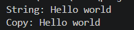

Задача 9:
Написать функцию, которая подсчитывает количество пробелов в строке, используя указатели для перемещения по символам строки.

Список идентификаторов 9:

| Имя переменной | Тип данных | Смысловое обозначение                                   |
| -------------- | ---------- | ------------------------------------------------------- |
| string         | char*      | Указатель на анализируемую строку (параметр функции)    |
| str            | char*      | Рабочий указатель для итерации по строке (копия string) |
| count          | int        | Счётчик найденных пробелов; инициализируется нулём      |
| text           | char[]     | Тестовая строка в main                                  |
| spaces         | int        | Переменная для хранения результата работы функции       |

Код программы 9:
```c
#include <stdio.h>

  

int count_spaces(char* string) {

    int count = 0; //счётчик

    while (*string != '\0') {

        if (*string == ' ') {//Если символ = пробел

            count++;

        }

        string++; //сдвиг

    }

    return count;

}

  

int main() {

    char text[] = "Hello world, chicken, cat, cucumber.";

  

    int spaces = count_spaces(text);//вызов функции

  

    printf("Text: %s\n", text);//просто вывод строки

    printf("Count spaces: %d", spaces);//вывод количества

  

    return 0;

}
```

Результат работы программы 9:

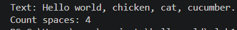

Задача 10:
Реализуйте функцию сортировки одномерного массива, которая принимает указатель на функцию сравнения. Эта функция сравнения должна определять порядок сортировки — по возрастанию или по убыванию. Внутри функции сортировки реализуйте обмен элементов массива местами с помощью функции swap, которая работает через указатели.

Список идентификаторов 10:

| Имя переменной     | Тип данных        | Смысловое обозначение                                         |
| ------------------ | ----------------- | ------------------------------------------------------------- |
| a, b (в swap)      | int*              | Указатели на два элемента, которые нужно поменять местами     |
| temp (в swap)      | int               | Временная переменная для обмена                               |
| array              | int*              | Указатель на первый элемент сортируемого массива              |
| size               | int               | Количество элементов в массиве                                |
| compare            | int (*)(int, int) | Указатель на функцию сравнения; определяет порядок сортировки |
| i                  | int               | Счётчик внешнего цикла (номер прохода)                        |
| j                  | int               | Счётчик внутреннего цикла (индекс сравниваемого элемента)     |
| a, b (в compare_*) | int               | Два значения, которые сравниваются функцией сравнения         |
| arr                | int[]             | Исходный массив в main                                        |
| choice             | int               | Выбор пользователя: 1 — по возрастанию, 2 — по убыванию       |

Код программы 10:
```c
#include <stdio.h>

  

void swap(int* a, int* b) {//функция замены элементов массива

    int temp = *a;//без указатеелй меняла бы только копии

    *a = *b;

    *b = temp;

}

  

void sort(int* array, int size, int(*compare)(int, int)) {

    //compare: указатель на функцию, которая возвращает 1, если элементы

    //нужно поменять местами, и 0, если порядок правильный

    for (int i = 0; i < size - 1; i++) {//количество проходов по массиву

  

        for (int j = 0; j < size - i - 1; j++) {//сравнение соседей

            //size - 1 -i тк после каждого прохода i элементов уже на своиъ местах

            if (compare(*(array + j), *(array + j + 1)))//передаём j и j+1 элементы

                swap((array + j), (array + j + 1));//если истина, то меняем местами

        }

    }

}

  

int compare_ascending(int a, int b) {//сортировка по возрастанию

    return a > b;

}

  

int compare_descending(int a, int b) {//по убыванию

    return a < b;

}

  

int main() {

    int arr[] = {52, 689, 1, 4, 40, 23};//исходный массив

    int size = sizeof(arr) / sizeof(arr[0]);//размер исходного массива

    int choise;

  

    printf("Start array: ");

    for (int i = 0; i < size; i++)

        printf("%d ", *(arr + i));

    printf("\n");

  

    printf("Choise sort please:\n");

    printf("1 - in ascending order\n");

    printf("2 - in descending order\n");

    printf("Your choise: ");

  

    if (scanf("%d", &choise) != 1 || (choise != 1 && choise != 2)) {

        printf("Incorrect input");

        return 1;//Пользователь выбирает вариант сортировки

    }

  

    if (choise == 1) {

        sort(arr, size, compare_ascending);//первый вариант

        printf("Final array(ascending): ");

    } else {

        sort(arr, size, compare_descending);//второй вариант

        printf("Final array(descending): ");

    }

  

    for (int i = 0; i < size; i++)

        printf("%d ", *(arr + i));

  

    return 0;

  

}
```

Результат работы программы 10:

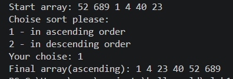

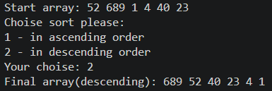

Выполнил студент ИИТТО 1 курса группы ПОО Кулешов Данила